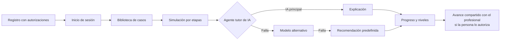

# 🩺 Colorrectal-Sim


Plataforma educativa de simulación sobre la **detección e interpretación del cáncer colorrectal mediante imágenes médicas multimodales**, con un agente tutor de inteligencia artificial que acompaña a la persona usuaria paso a paso.

Proyecto ONCO-AI_USC 2026 B · Línea 2 ONCO-SIM · Universidad Santiago de Cali.

> ⚠️ Colorrectal-Sim es una herramienta educativa. Sus resultados son experimentales de apoyo y **no reemplazan la valoración de un médico**.

---

## 🎯 Características

- **Casos de simulación por etapas** con imágenes de datasets públicos de colonoscopia.
- **Agente tutor de IA** que explica cada etapa en lenguaje sencillo, con respaldo automático si el servicio de IA falla.
- **Vínculo con el profesional de la salud**: la persona decide si comparte su avance.
- **Progreso y niveles** (Explorador, Analista, Experto).
- **Estudios propios**: la persona puede cargar imágenes de su colonoscopia; se quitan los datos personales, se guardan cifradas y un modelo experimental marca regiones de interés.
- **Protección de datos** según la Ley 1581 de 2012: autorizaciones que se pueden revocar, contraseñas con hash, supresión de la cuenta y exportación seudonimizada.
- **Accesible y en español**, pensado para personas con cáncer colorrectal y sus familias.

## 🚀 Tecnologías

| Capa | Tecnología |
|------|------------|
| Frontend | React 18 + TypeScript (Vite) |
| Backend | FastAPI, SQLAlchemy 2, Pydantic |
| Base de datos | PostgreSQL 16 |
| IA | Groq (`llama-3.3-70b-versatile` y `llama-3.1-8b-instant`), API compatible con OpenAI |
| Infraestructura | Docker Compose |
| Calidad | pytest + cobertura, ruff, gitleaks, GitHub Actions |

## 🧭 Flujo de la plataforma



## 📦 Instalación y configuración

### Requisitos

- [Docker Desktop](https://www.docker.com/products/docker-desktop/) (incluye Docker Compose)
- [Git](https://git-scm.com/)
- Para desarrollo sin Docker: Python 3.12, Node.js 20 y PostgreSQL 16

### Pasos

1. Clona el repositorio:

   ```bash
   git clone https://github.com/<organizacion>/colorrectal-sim.git
   cd colorrectal-sim
   ```

2. Crea tu archivo de variables de entorno y complétalo:

   ```bash
   cp .env.example .env
   ```

   La clave de la API de IA (`IA_API_KEY`) es opcional: sin ella el tutor usa la recomendación predefinida.

## 🏃 Ejecución

### Con Docker (recomendado)

```bash
docker compose up --build
```

| Servicio | Dirección |
|----------|-----------|
| Aplicación web | http://localhost:5173 |
| API | http://localhost:8000/api/v1 |
| Documentación de la API | http://localhost:8000/docs |

La base de datos se crea sola con los scripts de `db/` la primera vez.

### Sin Docker

```bash
# Backend
cd backend
python -m venv .venv && source .venv/bin/activate   # en Windows: .venv\Scripts\activate
pip install -r requirements.txt -r requirements-dev.txt
uvicorn app.main:app --reload

# Frontend (en otra terminal)
cd frontend
npm install
npm run dev
```

### Pruebas

```bash
cd backend
ruff check .
pytest --cov=app
```

Las pruebas de integración se ejecutan solo si `DATABASE_URL` apunta a una base con el esquema cargado.

## 📁 Estructura del proyecto

```
colorrectal-sim/
├── backend/
│   ├── app/
│   │   ├── core/              # configuración, base de datos, seguridad
│   │   ├── modules/
│   │   │   ├── usuarios/      # M01 registro, sesión, recuperación y administración
│   │   │   ├── vinculos/      # M01 vínculo con el profesional de la salud
│   │   │   ├── casos/         # M02 casos clínicos, editor y revisión
│   │   │   ├── simulacion/    # M03 simulación, M05 evaluación y M07 registro
│   │   │   ├── tutor/         # M04 agente tutor de IA
│   │   │   ├── gamificacion/  # M06 niveles e insignias (Observer)
│   │   │   ├── progreso/      # M08 progreso, panel del profesional y exportación
│   │   │   ├── privacidad/    # M09 autorizaciones y derechos del titular
│   │   │   └── estudios/      # M10 estudios propios y modelo de visión
│   │   └── main.py
│   ├── tests/
│   └── Dockerfile
├── frontend/
│   ├── src/
│   │   ├── paginas/           # pantallas 01 a 13
│   │   └── api.ts
│   └── Dockerfile
├── db/
│   ├── 01_schema.sql          # 19 tablas, índices y vista de exportación
│   ├── 02_catalogos.sql       # roles, niveles y datasets
│   ├── 03_ajustes_srs.sql     # campos que pide el SRS
│   └── 04_estudios_recuperacion.sql
├── vision/                    # entrenamiento del modelo de visión (Colab)
├── docs/                      # datasets, tutor de IA y estado de los requisitos
├── .github/                   # CI, plantillas de PR y defectos
└── docker-compose.yml
```

## 🎨 Funcionalidades por ciclo

| Ciclo | Fechas | Versión | Alcance |
|-------|--------|---------|---------|
| 1 | 9 al 12 de noviembre | v0.5 | Registro, inicio de sesión, catálogo de casos, tutor con respaldo |
| 2 | 13 al 16 de noviembre | v0.9 | Simulación por etapas, progreso, vínculo con el profesional |
| 3 | 17 al 20 de noviembre | v1.0 | Administración de casos, exportación seudonimizada, ajustes finales |
| Cierre | 20 al 29 de noviembre | v1.0 | Pruebas, informe de pruebas y entrega |

## 🐛 Solución de problemas

| Problema | Solución |
|----------|----------|
| `port is already allocated` | Otro programa usa el puerto 5432, 8000 o 5173. Ciérralo o cambia el puerto en `docker-compose.yml`. |
| La base no tiene tablas | Los scripts de `db/` solo se ejecutan la primera vez. Borra el volumen con `docker compose down -v` y vuelve a levantar. |
| El tutor siempre muestra la recomendación predefinida | Revisa `IA_API_KEY` en `.env`. |
| Error de CORS en el navegador | Agrega la dirección del frontend a `CORS_ORIGENES`. |

## 🚀 Despliegue

### Enlace público de demostración (Render)

`render.yaml` crea en Render, con el plan gratuito, la base PostgreSQL 16 y un solo servicio web (`despliegue/Dockerfile`) que sirve la API y el frontend en la misma dirección. Cada cambio en `develop` se publica solo.

1. En [Render](https://render.com) entra con GitHub y elige **New › Blueprint** sobre este repositorio.
2. Escribe en el panel `ADMIN_CORREO` y `ADMIN_CONTRASENA` (primer administrador) y, si se tiene, `IA_API_KEY`.
3. Al arrancar, `python -m app.preparar` carga el esquema, crea el administrador y publica un caso de demostración con texto de prueba.

Limitaciones del plan gratuito: el servicio se duerme tras 15 minutos sin uso y tarda cerca de un minuto en despertar; la base gratuita vence a los 30 días; los archivos subidos (imágenes de los casos) no se conservan al reiniciar. En la demostración (`ENTORNO=demostracion`) no se pueden cargar estudios propios, para no recibir datos reales de personas en un servidor de pruebas (Ley 1581 de 2012).

### Versión 1.0

Se entrega como contenedores Docker (`docker-compose.yml`).

## 🤝 Contribuir

Lee la [guía de contribución](CONTRIBUTING.md) antes de abrir un Pull Request.

## 👥 Equipo Medical programmers

| Integrante | GitHub | Rol en el desarrollo |
|------------|--------|----------------------|
| Nicolás Rivas Castillo | [@rivasnico356-png](https://github.com/rivasnico356-png) | Líder del proyecto, integración y documentación |
| David Steven Muñoz | [@Darksteven30](https://github.com/Darksteven30) | Backend, base de datos y Docker |
| Juan Camilo Paredes Ramírez | [@juanparedes247](https://github.com/juanparedes247) | Frontend |
| Valentina Ramírez | [@valentinaramirezs](https://github.com/valentinaramirezs) | Agente tutor de IA y modelo de visión |
| María Camila Viveros | [@camiviveros0-sketch](https://github.com/camiviveros0-sketch) | Pruebas e integración continua |

Dueño del proyecto: Jair Enrique Sanclemente Castro · Gestión de Proyectos TI 2026-B, Universidad Santiago de Cali.

## 📝 Licencia

Este proyecto usa la licencia [MIT](LICENSE). Los datasets de imágenes conservan sus propias licencias (ver [docs/datasets.md](docs/datasets.md)).

---

Elaborado por el equipo Medical programmers · Versión 1.0 de la documentación del repositorio.
