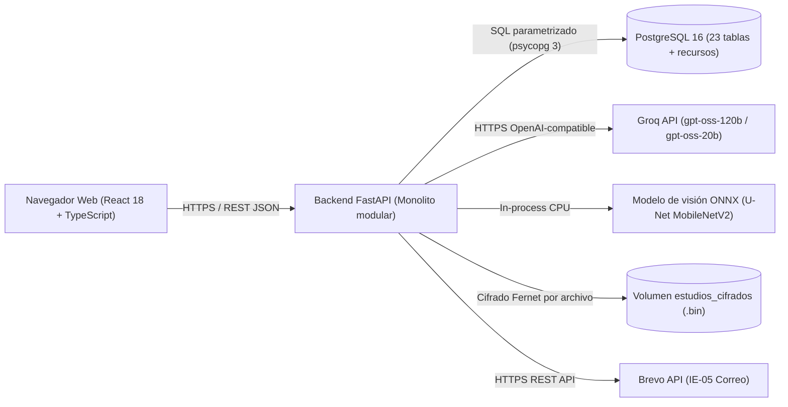
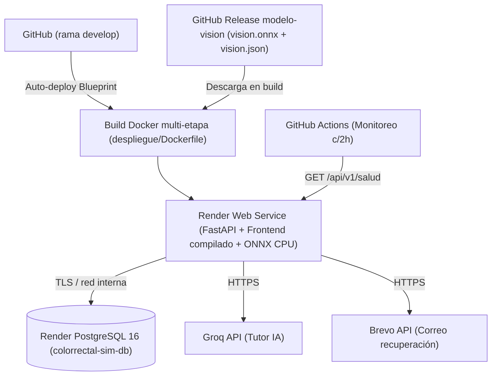

# 1.3.2.3 Arquitectura del sistema v1.1

| Campo | Detalle |
|---|---|
| **Proyecto** | Colorrectal-Sim — Plataforma educativa de simulación en cáncer colorrectal (ONCO-AI_USC 2026-B) |
| **Versión del documento** | **v1.1** (actualización de cierre de ciclo, tarea JC4) |
| **Fecha de emisión** | 21-11-2026 |
| **Equipo** | Medical programmers — Universidad Santiago de Cali |
| **Repositorio y demo** | `github.com/rivasnico356-png/colorrectal-sim` · `https://colorrectal-sim.onrender.com` |

---

## 1. Control de cambios respecto a la v1.0

Esta versión **v1.1** alinea la especificación de arquitectura con el sistema efectivamente implementado, verificado y desplegado:

1. **Despliegue real documentado**: coexistencia del despliegue local/entrega v1.0 en Docker Compose (3 contenedores) y el enlace público de demostración en Render (1 contenedor Docker unificado + PostgreSQL 16 administrado).
2. **ADR-06 reemplazada**: se descarta el servicio de inferencia separado con GPU; el modelo de visión en formato **ONNX** corre dentro del proceso del backend en CPU (`onnxruntime 1.20.1`).
3. **Nueva ADR-09**: adopción de **Render** (plan gratuito, `render.yaml`) para la demostración pública con despliegue automático desde `develop`.
4. **Cifrado Fernet por archivo**: protección en reposo de los estudios propios desidentificados mediante cifrado simétrico autenticado **Fernet** (`cryptography 50.0.2`), almacenando cada estudio como archivo cifrado `{id_estudio}.bin` en volumen dedicado.
5. **Persistencia sin ORM ni Alembic**: acceso a datos directo mediante consultas SQL parametrizadas sobre SQLAlchemy Core (`text()`) y evolución del esquema controlada por **7 scripts SQL numerados** (`db/01` a `db/07`) aplicados automáticamente por `app.preparar`.
6. **Correo electrónico por API HTTPS de Brevo**: reemplazo del envío SMTP directo en la demostración pública (bloqueado por Render gratuito) mediante la API REST de Brevo (`IE-05`), conservando STARTTLS como alternativa para instalaciones propias.
7. **Tabla de hardware y software con versiones exactas**: inventario verificado contra `requirements.txt`, `package.json`, `Dockerfiles` y flujos de GitHub Actions.

---

## 2. Estilo arquitectónico y vista lógica

Colorrectal-Sim implementa un **monolito modular** (**ADR-01**): una única aplicación backend en FastAPI organizada en módulos desacoplados por dominio funcional, consumida por una SPA en React + TypeScript a través de una API REST (`/api/v1`) y respaldada por PostgreSQL 16.

### 2.1 Módulos del backend (`backend/app/modules/`)

| Módulo | Paquete | Responsabilidad |
|---|---|---|
| **M01 Usuarios y acceso** | `usuarios/`, `vinculos/` | Registro, login JWT, cierre de sesión con revocación, recuperación de contraseña, gestión de roles y vínculo con profesional de la salud |
| **M02 Casos clínicos** | `casos/` | Creación, versionado, carga de imágenes/videos en BD (`recurso_contenido`), flujo de revisión por pares y catálogo filtrado |
| **M03 · M05 · M07 Simulación** | `simulacion/` | Gestión de intentos, etapas, evaluación de decisiones y observadores de interacción humano-IA |
| **M04 Agente tutor de IA** | `tutor/` | Cadena de validación de preguntas, estrategia de respaldo (Groq principal → Groq alternativo → explicación predefinida) y registro de latencia/prompt |
| **M06 Gamificación** | `gamificacion/` | Cálculo de puntajes, niveles (Explorador, Analista, Experto) e insignias mediante eventos de dominio |
| **M08 Progreso y reportes** | `progreso/` | Historial, métricas individuales, panel del profesional y exportación seudonimizada |
| **M09 Privacidad** | `privacidad/` | Consentimientos granulares (Ley 1581 de 2012), consulta, rectificación y supresión total de cuenta y estudios |
| **M10 Estudios propios** | `estudios/` | Desidentificación (EXIF/DICOM), cifrado Fernet por archivo, inferencia ONNX de pólipos y comentarios clínicos |

### 2.2 Patrones de diseño implementados

Los 8 patrones definidos en el documento de diseño (1.3.2.2) están implementados en el backend y verificados en `backend/tests/test_patrones.py`:

| Patrón | Ubicación (`backend/app/`) | Propósito |
|---|---|---|
| **Adapter** | `modules/tutor/proveedores.py` | Unifica proveedores LLM bajo el contrato `ProveedorLLM` |
| **Factory Method** | `modules/tutor/proveedores.py` (`FabricaProveedores`) | Instancia adaptadores según configuración |
| **Strategy** | `modules/tutor/servicio.py` (`ServicioTutor`) | Cadena de respaldo: IA principal → alternativo → explicación predefinida |
| **Facade** | `modules/tutor/fachada.py` (`FachadaTutor`) | Punto único de entrada al tutor (contexto, validación, respuesta, rótulo y registro) |
| **Chain of Responsibility** | `modules/tutor/validacion.py` | Filtros secuenciales: longitud → límite por etapa → tema → seguridad |
| **State** | `modules/casos/estados.py` (`CasoClinico`) | Transiciones controladas *borrador → revisado → publicado* con revisor distinto al autor |
| **Observer** | `core/eventos.py` (`BusEventos`) | Desacopla evaluación de registro humano-IA, progreso y gamificación en la misma transacción (**ADR-05**) |
| **Template Method** | `modules/estudios/procesamiento.py` (`ProcesadorImagen`) | Flujo fijo: calidad → desidentificación → normalización → análisis ONNX → registro |

---

## 3. Arquitectura de despliegue real

El sistema cuenta con **dos topologías reales de despliegue**: una para la entrega final y desarrollo local en Docker Compose, y otra para el enlace público de demostración en Render.

### 3.1 Entorno de demostración pública (Render — `render.yaml`)

Se despliega automáticamente con cada `push` o *merge* a la rama `develop` mediante un **único contenedor Docker multi-etapa** (`despliegue/Dockerfile`):

1. **Etapa `web` (`node:20-alpine`)**: compila la SPA React/TypeScript con `VITE_API_URL=/api/v1` (mismo origen, elimina peticiones CORS entre puertos).
2. **Etapa final (`python:3.12-slim`)**: instala dependencias del backend, copia los estáticos compilados a `/app/web`, copia `db/*.sql` y descarga los artefactos del modelo (`vision.onnx`, `vision.json`, `ejemplo-kvasir.jpg`) desde el GitHub Release `modelo-vision`.
3. **Arranque idempotente**: ejecuta `python -m app.preparar` (crea/actualiza esquema SQL, sincroniza administrador inicial y publica el caso de demostración con imagen HyperKvasir) y levanta `uvicorn` con `--proxy-headers`.
4. **Restricción legal en demostración**: `ENTORNO=demostracion` bloquea la carga de estudios propios (`HTTP 403`) para evitar recibir datos clínicos reales en un servidor de pruebas (Ley 1581 de 2012).

### 3.2 Entorno local / entrega v1.0 (`docker-compose.yml`)

Orquesta 3 contenedores aislados en red interna Docker:

| Servicio | Imagen / Build | Puerto expuesto | Volúmenes / Persistencia |
|---|---|---|---|
| `db` | `postgres:16` | `127.0.0.1:5432:5432` | `./db:/docker-entrypoint-initdb.d:ro`, volumen nombrado `datos_pg` |
| `backend` | `./backend/Dockerfile` (`python:3.12-slim`) | `8000:8000` | `./db:/app/db:ro`, `./backend/modelos:/app/modelos:ro`, `./data/media:/app/media`, volumen nombrado `estudios_cifrados:/app/estudios` |
| `frontend` | `./frontend/Dockerfile` (`node:20-alpine` → `nginx:1.27-alpine`) | `5173:80` | Estáticos compilados en `/usr/share/nginx/html` |

---

## 4. Persistencia de datos (sin ORM ni Alembic)

El backend **no utiliza modelos ORM ni migraciones con Alembic**. El acceso a PostgreSQL 16 se realiza mediante **SQLAlchemy 2.0.36 Core** (gestión de *pool* de conexiones y transacciones) con consultas SQL explícitas y parametrizadas (`text()`) sobre el controlador **psycopg 3 (`psycopg[binary] 3.2.3`)**.

### 4.1 Evolución del esquema mediante scripts SQL numerados

La base de datos contiene **23 tablas**, índices, restricciones y la vista de exportación seudonimizada, gestionados por **7 scripts SQL numerados** en `db/`:

| Script | Propósito | Estrategia de ejecución (`app.preparar`) |
|---|---|---|
| `db/01_schema.sql` | 19 tablas base, claves foráneas, restricciones e índices y vista de exportación | Solo en base vacía |
| `db/02_catalogos.sql` | Roles, niveles, insignias y catálogos iniciales | Solo en base vacía |
| `db/03_ajustes_srs.sql` | Campos adicionales del SRS y tablas `caso_version` y `sesion_revocada` | Solo en base vacía |
| `db/04_estudios_recuperacion.sql` | Tabla `recuperacion_contrasena` y avisos de comentarios en estudios | Solo en base vacía |
| `db/05_recursos_en_base.sql` | Tabla `recurso_contenido` (almacena imágenes/videos en `BYTEA` para sobrevivir reinicios en Render, con soporte HTTP Range para video) | **Idempotente** en cada arranque |
| `db/06_kvasir_seg.sql` | Histórico sin efecto (`SELECT 1;`) tras consolidación en HyperKvasir | **Idempotente** en cada arranque |
| `db/07_solo_hyperkvasir.sql` | Consolida el catálogo en el único dataset oficial **HyperKvasir** (CC BY 4.0) | **Idempotente** en cada arranque |

---

## 5. Seguridad, privacidad y cifrado Fernet por archivo

El diseño responde a **RNF-003**, **RF-009**, **RF-010 10.2** y la **Ley 1581 de 2012** (y Decreto 1377 de 2013):

1. **Desidentificación obligatoria de estudios propios** (`backend/app/modules/estudios/seguridad.py`):
   - Formatos admitidos: JPG, PNG y DICOM (`.dcm`), tamaño máximo **20 MB**.
   - Se extrae únicamente la matriz RGB de píxeles (en DICOM se descartan las **22 etiquetas identificadoras** como `PatientName`, `PatientID`, `InstitutionName`, fechas y seriales, y se alerta si existe `BurnedInAnnotation=YES`) y se regenera una imagen **PNG limpia** sin metadatos EXIF ni cabeceras clínicas.
2. **Cifrado Fernet por archivo en reposo**:
   - Cada imagen PNG desidentificada se cifra individualmente con **Fernet** (`cryptography 50.0.2`: AES-128-CBC + firma HMAC-SHA256) y se escribe como `{id_estudio}.bin` en el directorio `ESTUDIOS_DIR` (montado en volumen dedicado `estudios_cifrados`, accesible solo al contenedor del backend).
   - La clave Fernet de 32 bytes se deriva determinísticamente con `SHA-256` + `base64url` a partir de la variable de entorno `CLAVE_CIFRADO_ESTUDIOS` (nunca almacenada en el repositorio; **ADR-08**).
   - Al suprimir la cuenta (RF-009 9.3), se eliminan tanto los registros en BD como los archivos `.bin` cifrados del disco.
3. **Autenticación, sesiones y cabeceras HTTP**:
   - Contraseñas con **bcrypt 4.2.1**; sesiones con **JWT HS256 (`PyJWT 2.15.1`)** con identificador `jti` y tabla `sesion_revocada` para invalidación inmediata al cerrar sesión; bloqueo temporal tras 5 intentos fallidos (15 min).
   - Cabeceras de seguridad en `app/main.py` verificadas con **OWASP ZAP** (0 fallas, 0 avisos, 120 reglas): `X-Content-Type-Options: nosniff`, `X-Frame-Options: DENY`, `Referrer-Policy: no-referrer` y `Cross-Origin-Resource-Policy` (`same-origin` en API y `same-site` en `/media/`).
4. **Seudonimización en exportación (RNF-007)**:
   - Exportación de interacciones sin nombres ni correos, usando identificadores derivados con `SHA-256` y sal secreta (`SAL_SEUDONIMO`).

---

## 6. Servicio de correo electrónico por Brevo (IE-05)

Implementado en `backend/app/core/correo.py` para enlaces de recuperación de contraseña (vigencia de 30 minutos):

| Prioridad | Mecanismo | Condición de activación | Motivo |
|---|---|---|---|
| **1 (Producción / Render)** | **API HTTPS de Brevo** (`POST https://api.brevo.com/v3/smtp/email`, `httpx 0.28.1`, timeout 10 s) | `BREVO_API_KEY` configurada (con `SMTP_REMITENTE` verificado en Brevo) | El plan gratuito de Render bloquea los puertos SMTP salientes (25, 465 y 587) desde septiembre de 2025 |
| **2 (Instalación propia)** | **SMTP con STARTTLS** (`smtplib` + `ssl`) | `SMTP_SERVIDOR` configurado sin `BREVO_API_KEY` | Compatibilidad con servidores corporativos o institucionales en despliegues locales |
| **3 (Desarrollo / pruebas)** | **Buzón en memoria** (`buzon_desarrollo`) | Sin credenciales externas configuradas | Permite ejecutar pruebas automáticas y desarrollo local sin dependencias externas |

---

## 7. Registro de decisiones de arquitectura (ADR-01 a ADR-09)

| ID | Decisión | Estado | Resumen y motivo |
|---|---|---|---|
| **ADR-01** | Monolito modular en FastAPI | Vigente | Equipo de 5 personas y despliegue único; módulos separados con límites claros y bajo costo operativo |
| **ADR-02** | Frontend SPA en React 18 + TypeScript (Vite) | Vigente | Interfaz ligera, tipada y accesible (WCAG 2.1 AA) desacoplada por REST |
| **ADR-03** | PostgreSQL 16 sin ORM ni Alembic (scripts SQL numerados) | Vigente | Control exacto del modelo relacional (23 tablas), consultas parametrizadas con `psycopg 3` y despliegue idempotente con `db/01`–`07` |
| **ADR-04** | Agente tutor con adaptadores y cadena de respaldo | Vigente | Desacopla el proveedor LLM (Groq `gpt-oss-120b` → `gpt-oss-20b` → explicación predefinida) para que la simulación nunca se bloquee |
| **ADR-05** | Bus de eventos síncrono en la misma transacción | Vigente | Garantiza consistencia atómica entre evaluación, registro humano-IA, progreso y gamificación |
| **ADR-06** | ~~Microservicio separado de inferencia de visión con GPU~~ → **Modelo ONNX embebido dentro del backend en CPU** | **Reemplazada (v1.1)** | Se entrenó una **U-Net con MobileNetV2** (26 MB, Dice `0,872`, IoU `0,805` en HyperKvasir) exportada a ONNX; `onnxruntime 1.20.1` corre en CPU dentro del mismo proceso FastAPI sin GPU ni costos de infraestructura adicional, degradando limpiamente si el archivo no existe |
| **ADR-07** | Desidentificación + cifrado Fernet por archivo para estudios propios | Vigente | Cumple Ley 1581 de 2012 y RNF-003 sin almacenar metadatos clínicos ni imágenes en claro en disco |
| **ADR-08** | Configuración exclusivamente por variables de entorno | Vigente | Cero secretos en código o repositorio (verificado con `gitleaks v8.21.2`) |
| **ADR-09** | **Despliegue de demostración pública en Render (contenedor unificado + correo vía Brevo)** | **Nueva (v1.1)** | Permite ofrecer un enlace público HTTPS gratuito (`render.yaml`, auto-deploy desde `develop`) sirviendo API + frontend desde el mismo origen (sin CORS), recursos multimedia persistidos en BD (`db/05`), estudios propios deshabilitados por cumplimiento legal (`ENTORNO=demostracion`) y correo saliente por HTTPS (Brevo) ante el bloqueo SMTP de Render |

---

## 8. Tabla de hardware y software con versiones

### 8.1 Software de ejecución (producción y desarrollo)

| Capa | Componente / Paquete | Versión exacta | Rol en la arquitectura |
|---|---|---|---|
| **Backend (Runtime)** | Python | `3.12` (`python:3.12-slim`) | Intérprete del backend |
| **Backend (API)** | FastAPI / Starlette / Uvicorn | `0.162.5` / `1.10.0` / `0.32.1` | API REST ASGI, middleware de seguridad y estáticos |
| **Backend (Datos)** | SQLAlchemy Core / `psycopg[binary]` | `2.0.36` / `3.2.3` | Pool de conexiones y SQL parametrizado (sin ORM) |
| **Backend (Validación)** | `pydantic-settings` / `email-validator` / `python-multipart` | `2.6.1` / `2.2.0` / `0.0.33` | Configuración `.env`, validación de esquemas y carga de archivos |
| **Backend (Seguridad)** | `bcrypt` / `PyJWT` / `cryptography` (Fernet) | `4.2.1` / `2.15.1` / `50.0.2` | Hash de contraseñas, tokens JWT y cifrado en reposo por archivo |
| **Backend (HTTP / Correo)** | `httpx` | `0.28.1` | Cliente HTTPS hacia Groq API y Brevo API |
| **Backend (Imágenes / Visión)** | `pillow` / `pydicom` / `numpy` / `onnxruntime` | `13.0.0` / `3.0.2` / `2.1.3` / `1.20.1` | Desidentificación EXIF/DICOM e inferencia ONNX en CPU |
| **Frontend (Runtime / Build)** | Node.js / Vite / TypeScript | `20` (`node:20-alpine`) / `^5.4.11` / `5.6.3` | Compilación y servidor de desarrollo SPA |
| **Frontend (UI)** | React / React DOM / Nginx (Docker local) | `18.3.1` / `18.3.1` / `1.27-alpine` | Interfaz de usuario responsive y accesible |
| **Base de datos** | PostgreSQL | `16` (`postgres:16`) | Persistencia relacional (23 tablas) y almacenamiento `BYTEA` de medios |
| **Servicios externos (IA / Correo)** | Groq API (`openai/gpt-oss-120b`, `openai/gpt-oss-20b`) · Brevo API v3 | API REST v1 / v3 | Agente tutor con respaldo y envío de correos de recuperación |
| **Contenedores** | Docker / Docker Compose | Engine 24+ / Compose v2 | Empaquetado reproducible local y en Render |

### 8.2 Software de entrenamiento del modelo, pruebas y calidad (CI/CD)

| Área | Herramienta / Paquete | Versión exacta | Uso |
|---|---|---|---|
| **Calidad y pruebas backend** | `pytest` / `pytest-cov` / `ruff` | `8.3.4` / `6.0.0` / `0.8.4` | 74 pruebas unitarias/integración (90,76 % cobertura; umbral CI 70 %) y linting |
| **Pruebas E2E y accesibilidad** | `@playwright/test` / `@axe-core/playwright` / Lighthouse | `1.48.2` / `4.10.0` / `12` | Flujo completo en 5 navegadores y validación WCAG 2.1 A/AA |
| **Seguridad y carga** | `gitleaks` / OWASP ZAP / `pip-audit` / `npm audit` / Locust | `v8.21.2` / estable CI | Detección de secretos, escaneo DAST, vulnerabilidades y pruebas de carga/estrés |
| **Entrenamiento visión (`vision/`)** | PyTorch / Torchvision / `segmentation-models-pytorch` / `onnx` | `>=2.3` / `>=0.18` / `0.3.4` / `>=1.16` | Entrenamiento U-Net MobileNetV2 en CPU (GitHub Actions) y exportación ONNX |
| **CI/CD** | GitHub Actions | Runner `ubuntu-24.04` | Integración continua, pruebas no funcionales, monitoreo c/2 h y entrenamiento ONNX |

### 8.3 Especificaciones de hardware por entorno

| Entorno | CPU | Memoria RAM | Almacenamiento | Red / Notas |
|---|---|---|---|---|
| **Desarrollo local (Docker Compose o nativo)** | 2–4 núcleos x86_64 (64 bits) | 4 GB mínimo (8 GB recomendados con Docker) | 5 GB libres (nativo) · 10 GB libres (Docker Desktop + imágenes) | Sin GPU requerida (inferencia ONNX en CPU) |
| **Demostración pública (Render — plan gratuito)** | 0,1 vCPU compartida (Web) + instancia Postgres 16 gratuita | 512 MB RAM (Web) + 256 MB RAM (PostgreSQL) | Disco efímero en servicio Web (medios en BD) · 1 GB en PostgreSQL (expira a los 30 días) | HTTPS administrado; reposo tras 15 min de inactividad; SMTP saliente bloqueado (usa Brevo HTTPS) |
| **CI/CD y entrenamiento (`GitHub Actions`)** | 4 vCPU x86_64 (`ubuntu-24.04`) | 16 GB RAM | 14 GB SSD temporal | Entrenamiento de 30 épocas de U-Net MobileNetV2 en ~1,5 h sobre CPU |

---

## 9. 1.3.2.4 Justificación arquitectónica

Cada decisión de la arquitectura v1.1 responde de forma trazable a los atributos de calidad (RNF) y a las restricciones reales del proyecto:

1. **Rendimiento y escalabilidad (RNF-001)**:
   - El monolito modular en FastAPI + SQL parametrizado directo (sin sobrecarga de mapeo ORM) + inferencia ONNX en memoria demostró en pruebas de carga (Locust, 30 usuarios concurrentes, 32.532 peticiones) un **p90 de 10 ms con 0 % de fallas**, y en pruebas de estrés hasta **150 usuarios (5× el requisito)** un **p90 global de 31 ms y 0 % de fallas**, muy por debajo del umbral de 3 s.
2. **Disponibilidad y resiliencia (RNF-002)**:
   - La estrategia de respaldo en tres niveles del tutor (**ADR-04**: `gpt-oss-120b` → `gpt-oss-20b` → recomendación predefinida) y la carga tolerante a fallos del modelo ONNX (**ADR-06**) garantizan que una caída de terceros o la ausencia del modelo nunca interrumpan una simulación. El monitoreo en GitHub Actions valida `/api/v1/salud` cada 2 horas.
3. **Seguridad y cumplimiento legal — Ley 1581 de 2012 (RNF-003, RNF-007)**:
   - La desidentificación a píxeles puros + **cifrado Fernet por archivo** en volumen dedicado impide la exposición de datos personales o DICOM en disco. La separación por entorno (`ENTORNO=demostracion` bloquea carga de estudios reales en Render), la seudonimización con sal en exportación y las cabeceras verificadas con **OWASP ZAP (0 fallas, 0 avisos, 120 reglas)** y **gitleaks (0 secretos)** respaldan el cumplimiento normativo.
4. **Mantenibilidad, costo cero y reproducibilidad (ADR-01, ADR-03, ADR-06, ADR-09)**:
   - Embeber el modelo ONNX de 26 MB en el backend (reemplazando la ADR-06 original) elimina un segundo servicio, evita el costo de GPU y simplifica el despliegue a un solo contenedor en Render (**ADR-09**).
   - Usar scripts SQL numerados (`db/01`–`07`) aplicados de forma idempotente por `app.preparar` evita desincronizaciones entre el modelo de datos documentado y migraciones autogeneradas, además de permitir recrear todo el entorno de demostración automáticamente tras cualquier reinicio.
   - Adoptar la **API HTTPS de Brevo** resuelve de forma limpia la restricción real de red (bloqueo SMTP en Render) sin sacrificar la portabilidad a servidores SMTP institucionales.
5. **Accesibilidad y compatibilidad multidispositivo (RNF-005, RNF-008)**:
   - La SPA en React + TypeScript con CSS ligero obtuvo **100/100 en accesibilidad en Lighthouse 12** (escritorio y móvil) y **0 errores críticos de WCAG 2.1 A/AA** con `axe-core 4.10` en 10 pantallas a través de 5 navegadores (Chrome, Firefox, WebKit, Chrome Android y Safari iPhone) sin desbordamiento horizontal.
