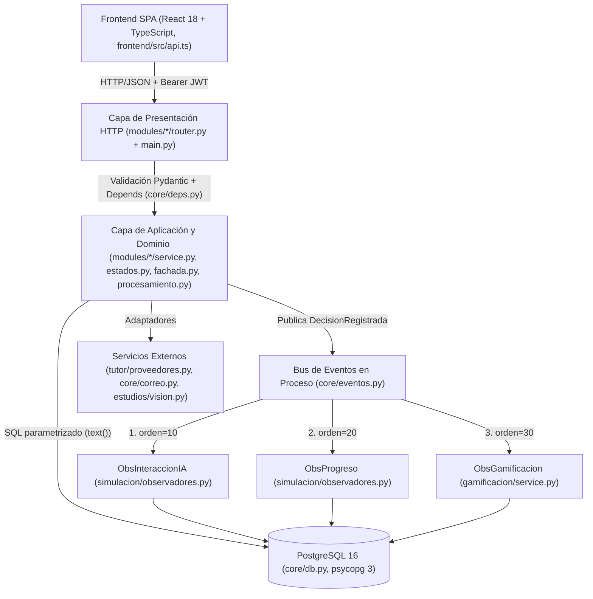

# 1.3.2.4 Arquitectura de software v1.1

| Campo | Detalle |
|---|---|
| **Proyecto** | Colorrectal-Sim — Plataforma educativa de simulación en cáncer colorrectal (ONCO-AI_USC 2026-B) |
| **Versión del documento** | **v1.1** (actualización de cierre de ciclo, tarea JC5 — secciones §4, §5 y §7) |
| **Fecha de emisión** | 21-11-2026 |
| **Equipo** | Medical programmers — Universidad Santiago de Cali |
| **Referencia** | 1.3.2.3 Arquitectura del sistema v1.1 · `docs/gitbook/api.md` · `docs/gitbook/arquitectura.md` |

---

## 1. Control de cambios respecto a la v1.0

1. **Estructura real de carpetas (§4)**: se actualiza el árbol de código al layout real del monolito modular bajo `backend/app/modules/`, incorporando explícitamente los módulos **`vinculos/`** y **`progreso/`** (junto con `casos/`, `estudios/`, `gamificacion/`, `privacidad/`, `simulacion/`, `tutor/` y `usuarios/`), `backend/app/core/` y la estructura real del frontend (`frontend/src/paginas/` y `frontend/public/`).
2. **Tabla de endpoints alineada a `docs/gitbook/api.md` (§5)**: se reemplaza la tabla preliminar por los **51 endpoints reales** implementados en FastAPI, coincidiendo exactamente con `docs/gitbook/api.md`.
3. **Escala de confianza corregida (§5)**: el contrato de la API (`POST /api/v1/intentos/{id_intento}/decisiones`) y la interfaz de usuario capturan y validan la confianza declarada en **escala entera de 1 a 5** (RF-003 3.5), **no de 0 a 100**.
4. **Documentación de decisiones sin `docs/adr/` (§7)**: se elimina la mención a una carpeta `docs/adr/` (que no existe en el repositorio); las decisiones de arquitectura (ADR-01 a ADR-09) residen en el documento **1.3.2.3 Arquitectura del sistema v1.1** y en `docs/gitbook/arquitectura.md`.

---

## 2. Arquitectura interna por capas y comunicación entre módulos

El backend organiza el software como un **monolito modular** en Python 3.12 / FastAPI con separación estricta de responsabilidades:



### Reglas estructurales del software
- **Comunicación frontend-backend**: toda interacción pasa por `frontend/src/api.ts` contra `/api/v1` (y `/media/recursos/{nombre}` para imágenes/videos de casos).
- **Aislamiento de integraciones externas**: ningún módulo invoca directamente APIs de terceros ni ejecuta modelos de ML desde los routers; se accede exclusivamente mediante adaptadores (`modules/tutor/proveedores.py`, `modules/estudios/vision.py` y `core/correo.py`).
- **Consistencia transaccional de eventos**: el bus de eventos (`core/eventos.py`) ejecuta los observadores de `DecisionRegistrada` de forma síncrona y ordenada (`ObsInteraccionIA` → `ObsProgreso` → `ObsGamificacion`) dentro de la misma transacción SQL (ADR-05).
- **Gestión de errores de negocio**: `core/errores.py` (`ErrorNegocio`) desacopla la lógica de dominio de los códigos HTTP devueltos por FastAPI.

---

## 3. §4 Estructura real de carpetas y módulos

### 3.1 Estructura del backend (`backend/app/`)

```text
backend/app/
├── main.py                      # Punto de entrada FastAPI, middleware CORS y cabeceras de seguridad, montaje de routers y /media
├── preparar.py                  # Arranque idempotente: aplica db/01–07, crea/sincroniza admin inicial y caso demo con imagen HyperKvasir
├── crear_admin.py               # Utilidad CLI para crear administradores manualmente
├── core/                        # Infraestructura transversal
│   ├── config.py                # Settings vía variables de entorno (pydantic-settings, ADR-08)
│   ├── correo.py                # IE-05: envío de correos (API HTTPS Brevo → SMTP STARTTLS → buzón en memoria)
│   ├── db.py                    # Engine SQLAlchemy Core (pool_pre_ping) y generador get_db()
│   ├── deps.py                  # Dependencias FastAPI de autenticación JWT y control de acceso por rol
│   ├── errores.py               # Excepción de dominio ErrorNegocio
│   ├── eventos.py               # Patrón Observer: BusEventos y evento DecisionRegistrada
│   ├── security.py              # Hash bcrypt, creación y decodificación de JWT (jti)
│   └── textos.py                # Rótulos obligatorios de transparencia de IA (RNF-007)
└── modules/                     # Módulos funcionales (monolito modular, ADR-01)
    ├── usuarios/                # M01: registro, login, logout, recuperación, perfil y administración de usuarios/roles
    │   ├── router.py
    │   ├── schemas.py
    │   └── service.py
    ├── vinculos/                # M01: solicitud, aceptación/rechazo y revocación de vínculos usuario–profesional
    │   └── router.py
    ├── casos/                   # M02: editor de casos, versionado, estados (State), medios en BD (BYTEA) y catálogo
    │   ├── estados.py
    │   ├── medios.py
    │   ├── router.py
    │   ├── schemas.py
    │   └── service.py
    ├── simulacion/              # M03, M05 y M07: intentos, etapas, evaluación de decisiones y observadores
    │   ├── observadores.py
    │   ├── router.py
    │   └── service.py
    ├── tutor/                   # M04: agente tutor IA (Facade, Chain of Responsibility, Strategy, Adapter, Factory Method)
    │   ├── fachada.py
    │   ├── prompt.py
    │   ├── proveedores.py
    │   ├── router.py
    │   ├── servicio.py
    │   └── validacion.py
    ├── gamificacion/            # M06: observador de puntaje acumulado, niveles (Explorador/Analista/Experto) e insignias
    │   └── service.py
    ├── progreso/                # M08: progreso individual, historial, panel del profesional y exportación CSV seudonimizada
    │   └── router.py
    ├── privacidad/              # M09: autorizaciones granulares, consulta de datos personales y derechos Ley 1581
    │   └── router.py
    └── estudios/                # M10: estudios propios, Template Method, desidentificación, cifrado Fernet y modelo ONNX
        ├── procesamiento.py
        ├── router.py
        ├── seguridad.py
        └── vision.py
```

### 3.2 Estructura del frontend (`frontend/`)

```text
frontend/
├── index.html                   # Documento raíz SPA (idioma es, favicon /isotipo.png)
├── public/
│   ├── logo.png                 # Logotipo completo con fondo transparente
│   └── isotipo.png              # Emblema circular (barra superior y favicon)
└── src/
    ├── main.tsx                 # Montaje de React 18
    ├── App.tsx                  # Estado de sesión, navegación por rol (RF-001 1.4), cabecera y pie
    ├── api.ts                   # Cliente HTTP fetch, gestión de Bearer token y tipos TypeScript
    ├── estilos.css              # Hoja de estilos responsive (RNF-005) y accesible (RNF-008)
    └── paginas/                 # Pantallas funcionales 01 a 13
        ├── Ingreso.tsx          # Pantalla 01: inicio de sesión
        ├── Registro.tsx         # Pantalla 02: registro y consentimientos
        ├── Recuperar.tsx        # Recuperación y restablecimiento de contraseña
        ├── Politica.tsx         # Política de tratamiento de datos (Ley 1581 / Decreto 1377)
        ├── Catalogo.tsx         # Pantalla 03: biblioteca y filtros de casos
        ├── Simulacion.tsx       # Pantallas 04–07: aviso, visor imagen/video + ROI, decisión, tutor IA, retroalimentación y resumen
        ├── Progreso.tsx         # Pantalla 08: métricas, barras, niveles e insignias
        ├── Estudios.tsx         # Pantalla 09: carga de estudios propios, ROI ONNX, compartir y comentarios
        ├── Privacidad.tsx       # Gestión de autorizaciones, vínculos, consulta y supresión de cuenta
        ├── Profesional.tsx      # Pantallas 10–12: panel de usuarios vinculados, estudios compartidos y editor/revisión de casos
        └── Admin.tsx            # Pantalla 13: administración de usuarios y roles
```

### 3.3 Correspondencia entre módulos de negocio y carpetas

| Módulo funcional | Carpeta en `backend/app/modules/` | Pantallas asociadas (`frontend/src/paginas/`) |
|---|---|---|
| M01 Usuarios y acceso | `usuarios/`, `vinculos/` | `Ingreso.tsx`, `Registro.tsx`, `Recuperar.tsx`, `Admin.tsx`, `Privacidad.tsx` |
| M02 Casos clínicos | `casos/` | `Catalogo.tsx`, `Profesional.tsx` (`EditorCasos`) |
| M03 Simulación · M05 Evaluación · M07 Interacción IA | `simulacion/` | `Simulacion.tsx` |
| M04 Agente tutor de IA | `tutor/` | `Simulacion.tsx` (panel `Tutor`) |
| M06 Gamificación | `gamificacion/` | `Simulacion.tsx` (logros), `Progreso.tsx` |
| M08 Progreso y reportes | `progreso/` | `Progreso.tsx`, `Profesional.tsx` (`PanelProfesional`) |
| M09 Privacidad | `privacidad/` | `Privacidad.tsx`, `Politica.tsx` |
| M10 Estudios propios y visión | `estudios/` | `Estudios.tsx`, `Profesional.tsx` (`EstudiosCompartidos`) |

---

## 4. §5 Contrato de la API REST y escala de confianza

### 4.1 Convenciones del contrato HTTP
- **Prefijo base**: `/api/v1` (salvo `GET /media/recursos/{nombre}`, montado en la raíz para servir imágenes y videos desde `recurso_contenido` con soporte de encabezados `Range`).
- **Documentación OpenAPI interactiva**: disponible en `/docs` (Swagger UI) y `/openapi.json`.
- **Autenticación**: `Authorization: Bearer <jwt>` obligatoria en todas las rutas, excepto `POST /auth/registro`, `POST /auth/login`, `POST /auth/recuperar`, `POST /auth/restablecer`, `GET /salud` y `GET /media/recursos/{nombre}`.
- **Control de acceso por rol**: aplicado mediante `requiere_rol(...)` en `core/deps.py` sobre los roles `Usuario`, `Profesional de la salud` y `Administrador`.

### 4.2 Tabla completa de endpoints (idéntica a `docs/gitbook/api.md`)

Total: **51 endpoints** (50 bajo `/api/v1` y 1 endpoint de medios en raíz):

| Método | Ruta | Módulo (`modules/` o `main.py`) |
|---|---|---|
| `PATCH` | `/admin/usuarios/{id_usuario}` | `usuarios/` |
| `GET` | `/admin/usuarios` | `usuarios/` |
| `POST` | `/admin/usuarios` | `usuarios/` |
| `POST` | `/auth/login` | `usuarios/` |
| `POST` | `/auth/logout` | `usuarios/` |
| `POST` | `/auth/recuperar` | `usuarios/` |
| `POST` | `/auth/registro` | `usuarios/` |
| `POST` | `/auth/restablecer` | `usuarios/` |
| `GET` | `/casos` | `casos/` |
| `GET` | `/datasets` | `casos/` |
| `PUT` | `/editor/casos/{id_caso}/etapas` | `casos/` |
| `POST` | `/editor/casos/{id_caso}/revision` | `casos/` |
| `GET` | `/editor/casos/{id_caso}/versiones` | `casos/` |
| `DELETE` | `/editor/casos/{id_caso}` | `casos/` |
| `GET` | `/editor/casos/{id_caso}` | `casos/` |
| `PUT` | `/editor/casos/{id_caso}` | `casos/` |
| `GET` | `/editor/casos` | `casos/` |
| `POST` | `/editor/casos` | `casos/` |
| `POST` | `/editor/etapas/{id_etapa}/recursos` | `casos/` |
| `POST` | `/estudios/{id_estudio}/comentarios` | `estudios/` |
| `PUT` | `/estudios/{id_estudio}/compartir` | `estudios/` |
| `GET` | `/estudios/{id_estudio}/imagen` | `estudios/` |
| `GET` | `/media/recursos/{nombre}` *(en raíz; imágenes y videos de casos con soporte de rangos)* | `casos/medios.py` |
| `DELETE` | `/estudios/{id_estudio}` | `estudios/` |
| `GET` | `/estudios/{id_estudio}` | `estudios/` |
| `GET` | `/estudios` | `estudios/` |
| `POST` | `/estudios` | `estudios/` |
| `GET` | `/exportacion/interacciones.csv` | `progreso/` |
| `POST` | `/intentos/{id_intento}/decisiones` | `simulacion/` |
| `POST` | `/intentos/{id_intento}/etapas/{id_etapa}/tutor` | `tutor/` |
| `GET` | `/intentos/{id_intento}/resumen` | `simulacion/` |
| `GET` | `/intentos/{id_intento}` | `simulacion/` |
| `POST` | `/intentos` | `simulacion/` |
| `GET` | `/notificaciones` | `estudios/` |
| `PUT` | `/privacidad/autorizaciones/{tipo}` | `privacidad/` |
| `GET` | `/privacidad/autorizaciones` | `privacidad/` |
| `GET` | `/privacidad/mis-datos` | `privacidad/` |
| `GET` | `/profesional/estudios` | `estudios/` |
| `GET` | `/profesional/panel` | `progreso/` |
| `GET` | `/profesional/usuarios/{id_usuario}/avance` | `progreso/` |
| `GET` | `/progreso/historial` | `progreso/` |
| `GET` | `/progreso` | `progreso/` |
| `GET` | `/simulacion/aviso` | `simulacion/` |
| `DELETE` | `/usuarios/me` | `usuarios/` |
| `GET` | `/usuarios/me` | `usuarios/` |
| `PATCH` | `/usuarios/me` | `usuarios/` |
| `DELETE` | `/vinculos/{id_vinculo}` | `vinculos/` |
| `PATCH` | `/vinculos/{id_vinculo}` | `vinculos/` |
| `GET` | `/vinculos` | `vinculos/` |
| `POST` | `/vinculos` | `vinculos/` |
| `GET` | `/salud` | `main.py` |

### 4.3 Contrato de decisión y escala de confianza (1 a 5)

En el endpoint `POST /api/v1/intentos/{id_intento}/decisiones` (`backend/app/modules/simulacion/router.py`), el esquema de entrada `DecisionIn` valida la confianza declarada como un **entero en escala de 1 a 5** (RF-003 3.5), **no de 0 a 100**:

```json
{
  "id_etapa": 1,
  "id_opcion": 2,
  "confianza": 4,
  "tiempo_ms": 14500
}
```

| Valor enviado (`confianza`) | Etiqueta en interfaz (`Simulacion.tsx`) | Validación API (`DecisionIn`) | Valor almacenado internamente en `decision.confianza_declarada` (`ObsInteraccionIA`) |
|---|---|---|---|
| `1` | Nada seguro | `ge=1, le=5` | `20` (`confianza * 20`) |
| `2` | Poco seguro | `ge=1, le=5` | `40` (`confianza * 20`) |
| `3` | Algo seguro | `ge=1, le=5` | `60` (`confianza * 20`) |
| `4` | Seguro | `ge=1, le=5` | `80` (`confianza * 20`) |
| `5` | Muy seguro | `ge=1, le=5` | `100` (`confianza * 20`) |

> **Nota técnica**: cualquier valor fuera de `[1, 5]` (por ejemplo `0` o `80`) es rechazado por Pydantic con `HTTP 422 Unprocessable Entity`. La conversión `confianza * 20` es un detalle interno de persistencia en `modules/simulacion/observadores.py` para compatibilidad con la columna `confianza_declarada` (0–100) del esquema SQL; el contrato de software (UI + API) trabaja exclusivamente en escala **1 a 5**. *(Distinto del campo de salida `modelo_vision.confianza`, que sí expresa un porcentaje 0–100 devuelto por la inferencia ONNX).*

---

## 5. §7 Documentación técnica, trazabilidad y gobierno del repositorio

### 5.1 Organización real de `docs/` (sin carpeta `docs/adr/`)

La documentación técnica del repositorio se mantiene sincronizada con GitBook (`docs/gitbook/`) y documentos operativos en `docs/`:

```text
docs/
├── bitacora.md                  # Bitácora cronológica de hitos, defectos y corridas CI
├── datasets.md                  # Licencias y trazabilidad de HyperKvasir (CC BY 4.0)
├── estado-requisitos.md         # Estado de cumplimiento de RF y RNF
├── pruebas-no-funcionales.md    # Evidencia de carga, estrés, OWASP ZAP, Lighthouse y Playwright/axe
├── tutor-ia.md                  # Especificación operativa del agente tutor
└── gitbook/                     # Sitio publicado en https://colorrectal-sim.gitbook.io/colorrectal-sim-docs/
    ├── README.md
    ├── SUMMARY.md
    ├── proyecto.md
    ├── funcionalidades.md
    ├── arquitectura.md          # Vista de arquitectura y decisiones vigentes (ADR)
    ├── datos.md                 # Modelo de datos y protección Ley 1581
    ├── api.md                   # Tabla oficial de los 51 endpoints REST
    ├── tutor-ia.md
    ├── modelo-vision.md
    ├── instalacion.md
    ├── pruebas.md
    ├── equipo.md
    ├── gestion.md
    └── referencias.md
```

> **Decisión sobre `docs/adr/`**: se **elimina** la referencia a una carpeta `docs/adr/` que figuraba en la versión v1.0. Para un equipo de 5 personas y 9 decisiones de arquitectura, mantener archivos ADR dispersos duplicaba el mantenimiento; todas las decisiones (ADR-01 a ADR-09) quedan centralizadas en **1.3.2.3 Arquitectura del sistema v1.1** y resumidas en `docs/gitbook/arquitectura.md`, con referencias cruzadas directas en los docstrings del código (`main.py`, `config.py`, `eventos.py`, `proveedores.py`).

### 5.2 Reglas de calidad y verificación automática del software

| Verificación | Herramienta / Archivo | Criterio vigente en CI (`.github/workflows/ci.yml`) |
|---|---|---|
| Estilo y análisis estático Python | `ruff 0.8.4` (`backend/pyproject.toml`, reglas `E, F, I, B, UP`, longitud 145) | 0 errores |
| Pruebas unitarias, patrones e integración | `pytest 8.3.4` + `pytest-cov 6.0.0` (`backend/tests/`) | 74 pruebas aprobadas · cobertura real **90,76 %** (falla la CI si baja de **70 %**) |
| Verificación de tipos y empaquetado frontend | `tsc -b && vite build` (`frontend/package.json`) | 0 errores de TypeScript/Vite |
| Pruebas E2E y accesibilidad WCAG 2.1 AA | Playwright `1.48.2` + `axe-core 4.10.0` (`e2e/pruebas/flujo-usuario.spec.ts`) | 5 navegadores aprobados · 0 errores críticos de accesibilidad en 10 pantallas |
| Control de secretos | `gitleaks v8.21.2` | 0 secretos detectados en todo el historial |
| Flujo de ramas | `CONTRIBUTING.md` | `main`, `qa` y `develop` protegidas; todo cambio entra por `feature/*` o `fix/*` mediante Pull Request revisado |
