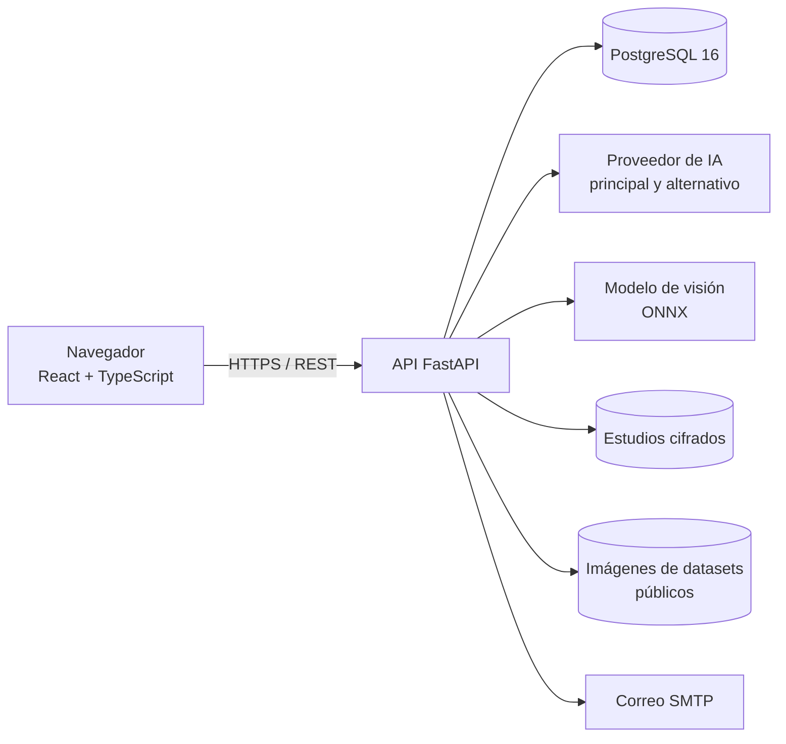

# Arquitectura

Colorrectal-Sim es un **monolito modular** (ADR-01): una sola API con módulos separados por responsabilidad, un frontend web y una base de datos relacional, todo en contenedores Docker.

## Módulos del backend

| Módulo | Carpeta | Responsabilidad |
|---|---|---|
| M01 Usuarios y acceso | `usuarios/`, `vinculos/` | Registro, sesión, recuperación, roles, administración y vínculo |
| M02 Casos clínicos | `casos/` | Editor, versiones, recursos, revisión y catálogo |
| M03 Simulación · M05 Evaluación · M07 Interacción | `simulacion/` | Intentos, etapas, decisiones, puntaje y registro |
| M04 Tutor de IA | `tutor/` | Fachada hacia la IA con respaldo |
| M06 Gamificación | `gamificacion/` | Niveles e insignias |
| M08 Reportes | `progreso/` | Historial, progreso, panel y exportación |
| M09 Privacidad | `privacidad/` | Autorizaciones y derechos del titular |
| M10 Estudios propios | `estudios/` | Desidentificación, cifrado, modelo de visión y comentarios |

## Patrones de diseño

| Patrón | Dónde | Para qué |
|---|---|---|
| Adapter | `tutor/proveedores.py`, `estudios/vision.py` | Mismo contrato para cualquier proveedor de IA o modelo |
| Strategy | `tutor/servicio.py` | Cadena IA principal → alternativo → recomendación predefinida |
| Factory Method | `tutor/servicio.py::crear_servicio` | Arma la cadena desde la configuración |
| Observer | `core/eventos.py` | La evaluación publica *DecisionRegistrada* y la gamificación reacciona sin acoplarse |

## Reglas

* El frontend solo habla con la API REST.
* Los módulos no llaman servicios externos directamente: lo hacen por adaptadores.
* Las claves se leen de variables de entorno; nunca están en el repositorio.
