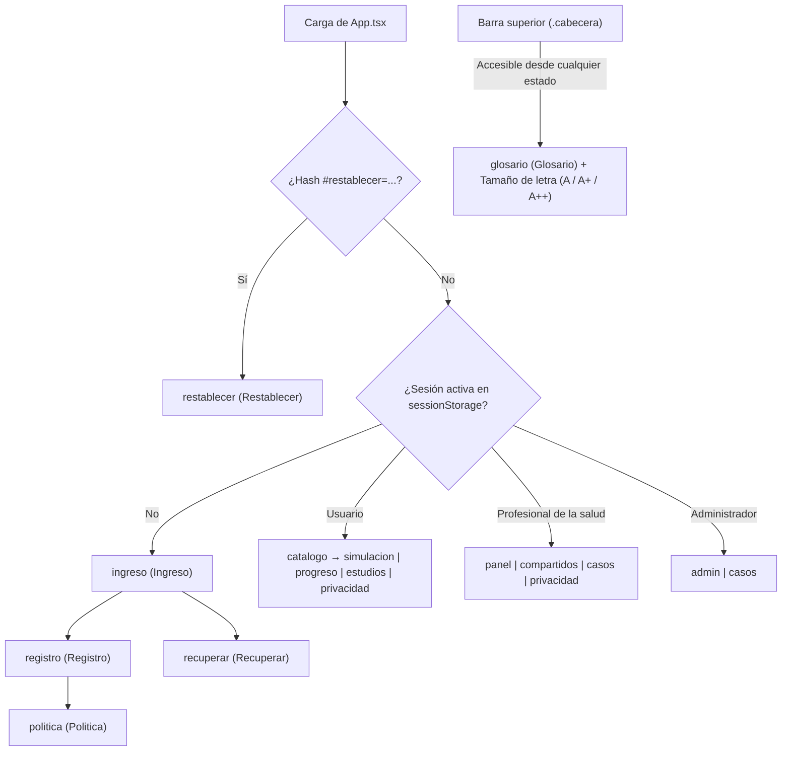

# 1.3.2.1 Interfaz y módulos v1.1

| Campo | Detalle |
|---|---|
| **Proyecto** | Colorrectal-Sim — Plataforma educativa de simulación en cáncer colorrectal (ONCO-AI_USC 2026-B) |
| **Versión del documento** | **v1.1** (actualización de cierre de ciclo, tarea JC7 + soporte RNF-008 de tarea JC8) |
| **Fecha de emisión** | 21-11-2026 |
| **Equipo** | Medical programmers — Universidad Santiago de Cali |
| **Referencia** | SRS v1.2 · `frontend/src/App.tsx` · `frontend/src/paginas/` |

---

## 1. Control de cambios respecto a la v1.0

1. **Tabla completa de trazabilidad pantalla ↔ componente real**: se relaciona cada pantalla funcional (01–13 y vistas complementarias) con su componente React real, archivo fuente, valor de estado `Pantalla`, rol habilitado y módulo del backend.
2. **Pantallas agregadas**: se documentan explícitamente **Recuperar contraseña** (`Recuperar` y `Restablecer`), **Mis datos** (`Privacidad`) y **Estudios compartidos** (`EstudiosCompartidos`), junto con **Política de tratamiento de datos** (`Politica`) y **Glosario de términos médicos** (`Glosario`, RNF-008).
3. **Aclaración de «enrutador del cliente»**: se precisa que el frontend **no usa React Router ni rutas del historial (`History API`)**; la navegación es **por estado** mediante `useState<Pantalla>` en `frontend/src/App.tsx`, con uso puntual del hash `#restablecer=<token>` solo para el enlace de recuperación de contraseña.
4. **Accesibilidad en interfaz (RNF-008)**: se incorporan el **Glosario de términos médicos** accesible desde cualquier pantalla y el **control global de tamaño de letra** (`A`, `A+`, `A++`) en la barra superior.

---

## 2. Aclaración sobre el «enrutador del cliente»: navegación por estado

A diferencia de aplicaciones que dependen de bibliotecas de enrutamiento por URL (como `react-router-dom`), **Colorrectal-Sim implementa navegación por estado en el componente raíz `frontend/src/App.tsx`**:

- **Estado de pantalla**: `const [pantalla, setPantalla] = useState<Pantalla>(...)`, donde `Pantalla` es una unión discriminada de 15 vistas (`"ingreso" | "registro" | "recuperar" | "restablecer" | "politica" | "glosario" | "catalogo" | "simulacion" | "progreso" | "estudios" | "privacidad" | "panel" | "compartidos" | "casos" | "admin"`).
- **Menú dinámico por rol (RF-001 1.4)**: el mapa `MENU: Record<Rol, [Pantalla, string][]>` y la pantalla inicial `INICIO: Record<Rol, Pantalla>` determinan qué botones ve cada rol al autenticarse (`Usuario` → `"catalogo"`, `Profesional de la salud` → `"panel"`, `Administrador` → `"admin"`).
- **Estado de sesión**: el token JWT y el rol se persisten en `sessionStorage` (`"sesion"`), evitando perder la sesión al recargar.
- **Única excepción por URL (`window.location.hash`)**: los correos de recuperación de contraseña apuntan a `/#restablecer=<token>`. Al cargar `App.tsx`, si `window.location.hash` inicia con `#restablecer=`, el estado inicial se posiciona en `"restablecer"` y al guardar la nueva clave limpia el hash.
- **Ventaja técnica**: cero dependencias externas de enrutamiento, despliegue directo sobre Nginx o FastAPI `StaticFiles(html=True)` sin reglas de reescritura de URL, y retorno inmediato a la pantalla de origen en vistas transversales (`origenPolitica` y `origenGlosario`).

---

## 3. Tabla de pantallas y componentes reales

| Pantalla / Vista | Estado (`Pantalla`) | Componente(s) React real(es) | Archivo (`frontend/src/paginas/`) | Roles con acceso | Módulo backend / Req. |
|---|---|---|---|---|---|
| **01 · Inicio de sesión** | `"ingreso"` | `Ingreso` | `Ingreso.tsx` | Público | M01 (`usuarios/`) · RF-001 1.2 |
| **02 · Registro** | `"registro"` | `Registro` | `Registro.tsx` | Público | M01 (`usuarios/`) · RF-001 1.1 |
| **Recuperar contraseña** *(nueva)* | `"recuperar"` / `"restablecer"` | `Recuperar`, `Restablecer` | `Recuperar.tsx` | Público | M01 (`usuarios/`, `core/correo.py`) · RF-001 1.3 |
| **Política de tratamiento de datos** | `"politica"` | `Politica` | `Politica.tsx` | Público y autenticados | M09 (`privacidad/`) · Ley 1581 / Decreto 1377 |
| **Glosario de términos médicos** *(nueva, JC8)* | `"glosario"` | `Glosario` | `Glosario.tsx` | Público y autenticados | Frontend · RNF-008 |
| **03 · Biblioteca de casos** | `"catalogo"` | `Catalogo` | `Catalogo.tsx` | Usuario | M02 (`casos/`) · RF-002 2.6, RF-006 6.1 |
| **04 · Aviso de alcance** | `"simulacion"` | `Simulacion` *(vista previa al intento)* | `Simulacion.tsx` | Usuario | M03 (`simulacion/`) · RF-003 3.1 |
| **05 · Resolver etapa (visor + decisión + tutor IA)** | `"simulacion"` | `EtapaVista`, `Visor`, `VisorVideo`, `Tutor` | `Simulacion.tsx` | Usuario | M03, M04, M10 (`simulacion/`, `tutor/`, `estudios/vision.py`) · RF-003, RF-004 |
| **06 · Retroalimentación** | `"simulacion"` | `Retroalimentacion` | `Simulacion.tsx` | Usuario | M05, M06 (`simulacion/`, `gamificacion/`) · RF-005, RF-006 |
| **07 · Resumen del caso** | `"simulacion"` | `ResumenCaso` | `Simulacion.tsx` | Usuario | M05, M07 (`simulacion/`) · RF-005 5.4 |
| **08 · Mi progreso** | `"progreso"` | `Progreso`, `VistaProgreso` | `Progreso.tsx` | Usuario | M06, M08 (`progreso/`, `gamificacion/`) · RF-008 8.1–8.2 |
| **09 · Mis estudios** | `"estudios"` | `Estudios`, `ImagenEstudio`, `VistaEstudio` | `Estudios.tsx` | Usuario | M10 (`estudios/`) · RF-010 10.1–10.5 |
| **Mis datos y privacidad** *(nueva)* | `"privacidad"` | `Privacidad` | `Privacidad.tsx` | Usuario, Profesional de la salud | M01, M09 (`privacidad/`, `vinculos/`, `usuarios/`) · RF-001 1.6, RF-009 |
| **10–11 · Casos clínicos (editor y revisión)** | `"casos"` | `EditorCasos`, `EditorEtapa` | `Profesional.tsx` | Profesional de la salud, Administrador | M02 (`casos/`) · RF-002 2.1–2.5 |
| **12 · Usuarios vinculados (panel profesional)** | `"panel"` | `PanelProfesional` *(reutiliza `VistaProgreso`)* | `Profesional.tsx` | Profesional de la salud | M08 (`progreso/`, `vinculos/`) · RF-007 7.2, RF-008 8.3–8.4 |
| **Estudios compartidos** *(nueva)* | `"compartidos"` | `EstudiosCompartidos` *(reutiliza `VistaEstudio`)* | `Profesional.tsx` | Profesional de la salud | M10 (`estudios/`) · RF-010 10.4 |
| **13 · Usuarios y roles** | `"admin"` | `Admin` | `Admin.tsx` | Administrador | M01 (`usuarios/`) · RF-001 1.1, 1.5 |

> **Nota sobre diseño responsive (pantallas 14 y 15 en v1.0)**: no existen componentes separados para móvil; el comportamiento móvil está integrado en todas las vistas mediante reglas CSS responsive (`@media (max-width: 900px)`, `min-width: 0`, tablas desplazables) en `frontend/src/estilos.css`, validado en Chrome Android y Safari iPhone (RNF-005).

---

## 4. Detalle de las pantallas incorporadas en v1.1

### 4.1 Recuperar contraseña (`Recuperar.tsx`)
- **`Recuperar` (`pantalla = "recuperar"`)**: solicita el correo electrónico y llama a `POST /api/v1/auth/recuperar` (envío por Brevo HTTPS o SMTP). Muestra respuesta genérica sin revelar si el correo existe.
- **`Restablecer` (`pantalla = "restablecer"`)**: activada por el enlace `#restablecer=<token>`; valida la nueva contraseña (mínimo 8 caracteres, letras y números) y llama a `POST /api/v1/auth/restablecer` (token de un solo uso con vigencia de 30 minutos).

### 4.2 Mis datos (`Privacidad.tsx`)
- Centraliza el ejercicio de derechos del titular bajo la **Ley 1581 de 2012** y el **vínculo con el profesional de la salud** (RF-009 y RF-001 1.6):
  1. Consulta y actualización de nombre (`GET /privacidad/mis-datos`, `PATCH /usuarios/me`).
  2. Gestión granular de autorizaciones con versión y fecha (`PUT /privacidad/autorizaciones/{tipo}`) y enlace a `Politica`.
  3. Creación, control de permiso de visibilidad y revocación de vínculos con profesionales (`GET/POST/PATCH/DELETE /vinculos`).
  4. Supresión irreversible de la cuenta confirmada con contraseña (`DELETE /usuarios/me`), borrando también los estudios cifrados.

### 4.3 Estudios compartidos (`EstudiosCompartidos` en `Profesional.tsx`)
- Permite al **Profesional de la salud** listar los estudios que sus usuarios vinculados autorizaron compartir (`GET /profesional/estudios`), abrir la imagen desidentificada con la ROI del modelo ONNX reutilizando `VistaEstudio` (`GET /estudios/{id}` y `GET /estudios/{id}/imagen`), y publicar comentarios educativos (`POST /estudios/{id}/comentarios`) que disparan notificaciones (`GET /notificaciones`) en la barra superior del usuario.

### 4.4 Glosario de términos médicos y control de tamaño de letra (RNF-008)
- **`Glosario.tsx` (`pantalla = "glosario"`)**: ofrece búsqueda instantánea y filtro por categoría (*Diagnóstico y estudios*, *Hallazgos y enfermedad*, *Tratamiento y seguimiento*, *Inteligencia artificial y datos*) con 18 términos en lenguaje sencillo. Accesible desde la barra superior antes y después de iniciar sesión, regresando al estado previo (`origenGlosario`).
- **Control de tamaño de letra (`App.tsx` + `estilos.css`)**: grupo accesible (`role="group"`, `aria-label="Tamaño de letra"`, `aria-pressed`) con tres niveles persistidos en `localStorage` (`A` = 100 %, `A+` = 118,75 %, `A++` = 137,5 %) aplicados sobre la raíz `html[data-texto]` con tipografía en unidades `rem`.

---

## 5. Módulos transversales de la interfaz

| Archivo (`frontend/src/`) | Responsabilidad |
|---|---|
| `App.tsx` | Contenedor principal, estado de sesión (`sessionStorage`), navegación por estado (`Pantalla`), menú por rol, sondeo de notificaciones (`60 s`), acceso a `Glosario` y control de tamaño de letra |
| `api.ts` | Cliente `fetch` unificado (`api`, `enviar`), inyección del encabezado `Authorization: Bearer`, manejo de `ErrorApi`, constante `MEDIA` y tipos TypeScript del dominio |
| `estilos.css` | Sistema de variables CSS, tipografía escalable en `rem` (RNF-008), visor con superposición de ROI, cuadrícula de simulación y reglas responsive `@media (max-width: 900px)` (RNF-005) |
| `main.tsx` | Punto de entrada React 18 (`StrictMode` + `createRoot`) |
